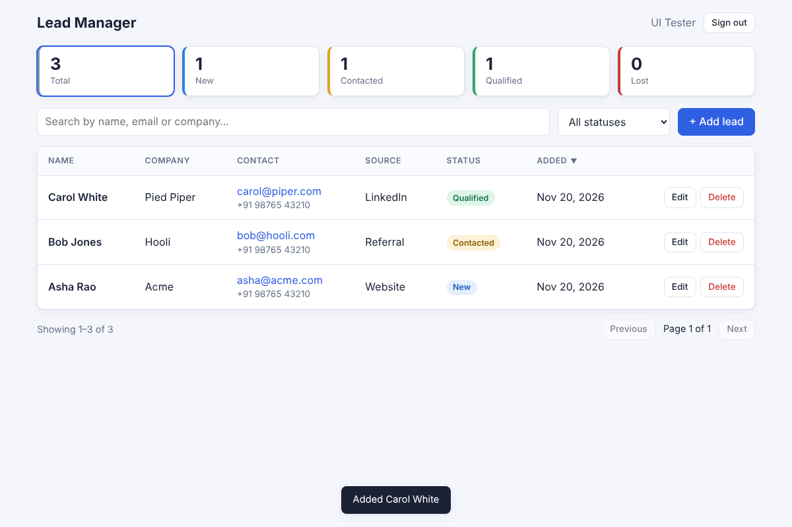
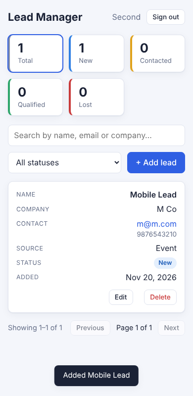

# Lead Manager

A small full-stack web app for a sales user to capture and track leads: add, list, edit, delete, search and filter, with per-user accounts.

| Desktop | Mobile |
| --- | --- |
|  |  |

**Live demo:** not deployed (see [Deployment](#deployment) for how to).

## Features

**Required**

- Add a lead: name, email, phone, company, source (dropdown), status (New / Contacted / Qualified / Lost)
- Leads table with colour-coded status badges
- Edit a lead and update its status
- Delete with a confirmation dialog
- Search by name (also matches email and company) and filter by status
- Validation on both the frontend (instant feedback) and the backend (source of truth), with field-level error messages

**Bonus (all done)**

- Signup / login (JWT); every user only sees their own leads
- Pagination and sortable columns
- Dashboard counts per status (the cards double as quick filters)
- Automated API tests (25, `node:test` + supertest)
- Deployment-ready: the API serves the built frontend, so it runs as a single service

## Tech stack and why

| Layer | Choice | Why |
| --- | --- | --- |
| Frontend | React 19 + Vite, plain CSS | Matches the team's stack; no UI library keeps the bundle small (~74 kB gzipped) and the styling easy to read |
| Backend | Node.js + Express 5 | Matches the team's stack; small, explicit, easy to follow |
| Database | SQLite via Node's built-in `node:sqlite` | Zero setup for reviewers: no database server and no native module to compile, so `npm install` works on any machine. Real SQL, foreign keys and indexes. The driver is still marked experimental in Node 22, which is fine for this scope; swapping to PostgreSQL would only touch `db.js` and the query calls |
| Auth | bcrypt password hashes + JWT bearer tokens | Stateless and simple |
| Tests | `node:test` + supertest | No extra test framework; runs against an in-memory database |

## Run it locally

Requires Node.js 22.13 or newer (built-in SQLite driver and glob support in the test runner).

```bash
# 1. Install dependencies for both apps
npm run install:all

# 2. Configure the API (defaults work for local dev, so this step is optional)
cp server/.env.example server/.env

# 3. Start the API (http://localhost:4000) and the frontend (http://localhost:5173) in two terminals
npm run dev:server
npm run dev:client
```

Open http://localhost:5173, create an account, and add some leads. The Vite dev server proxies `/api` to the API, so there is no CORS setup to do.

**Production-style single process** (API serves the built frontend):

```bash
npm run build
NODE_ENV=production JWT_SECRET=<long-random-string> npm start   # http://localhost:4000
```

**Tests**

```bash
npm test
```

### Environment variables (`server/.env.example`)

| Variable | Default | Notes |
| --- | --- | --- |
| `PORT` | `4000` | |
| `JWT_SECRET` | dev-only fallback | **Required** when `NODE_ENV=production`; the server refuses to start without it |
| `JWT_EXPIRES_IN` | `7d` | |
| `DATABASE_FILE` | `./data/leads.db` | Created automatically |
| `CORS_ORIGIN` | `*` | Comma-separated origins. Only needed if the frontend is hosted separately |

The client reads an optional `VITE_API_URL` (`client/.env.example`) for the same hosted-separately case.

## Project structure

```
server/
  src/
    index.js          entry point: config, DB, listen
    app.js            createApp(db, config): middleware + routes (injectable, so tests use :memory:)
    db.js             schema + indexes
    validation.js     lead / signup / login validation
    constants.js      statuses and sources
    errors.js         HttpError helpers
    middleware.js     JWT auth, error handler
    routes/           auth.js, leads.js
  tests/              API tests
client/
  src/
    api.js            fetch wrapper: token, error normalisation, network-failure handling
    AuthContext.jsx   session state
    validation.js     client-side mirror of the server rules
    components/       AuthPage, LeadsPage, LeadsTable, LeadForm, ConfirmDelete, StatsBar, Pagination, Modal, Field
```

## API

All `/api/leads` routes require `Authorization: Bearer <token>` and are scoped to the logged-in user.

| Method | Path | Description |
| --- | --- | --- |
| POST | `/api/auth/signup` | `{ name, email, password }` returns `{ token, user }` |
| POST | `/api/auth/login` | `{ email, password }` returns `{ token, user }` |
| GET | `/api/auth/me` | Current user |
| GET | `/api/leads` | Query: `q`, `status`, `sort` (name, company, status, source, created_at, updated_at), `order` (asc, desc), `page`, `limit` (max 100). Returns `{ data, pagination }` |
| GET | `/api/leads/stats` | `{ total, byStatus }` |
| GET | `/api/leads/meta` | Allowed statuses and sources |
| GET | `/api/leads/:id` | One lead |
| POST | `/api/leads` | Create (status defaults to `New`) |
| PUT | `/api/leads/:id` | Update, including status |
| DELETE | `/api/leads/:id` | Delete (204) |
| GET | `/api/health` | Liveness check |

**Errors** are always JSON `{ error, details? }`: `400` bad request or malformed JSON, `401` unauthenticated, `404` not found (including other users' leads), `409` duplicate email, `422` validation failure with `details` keyed by field name.

## Database design

```
users (id, name, email UNIQUE NOCASE, password_hash, created_at)
leads (id, user_id -> users ON DELETE CASCADE, name, email, phone, company,
       source, status CHECK IN (...), created_at, updated_at)
indexes: leads(user_id, status), leads(user_id, created_at)
```

Every lead query is filtered by `user_id`, so the composite indexes cover the status filter and the default sort. `status` has a `CHECK` constraint so bad data can't get in even if the API layer is bypassed.

## Decisions and assumptions

- **Source options** weren't specified, so I chose: Website, Referral, LinkedIn, Cold Call, Email Campaign, Event, Other. They live in one place (`server/src/constants.js`) and the frontend fetches them from `/api/leads/meta`.
- **All five contact fields are required**, as the brief lists them without "optional". Phone accepts 7-20 digits with `+ - ( ) .` and spaces; it is not validated per country.
- **Search** matches name (as required) plus email and company, case-insensitively. `%` and `_` are escaped so they search literally.
- **Duplicate leads** (same email) are allowed: the same person can legitimately be a lead for two companies, and the brief doesn't ask for de-duplication.
- **Security basics:** bcrypt hashing, a login that takes the same time for unknown emails, a rate limit on `/api/auth`, `helmet`, a 100 kB body limit, a sort-column whitelist and parameterised SQL (no string-built queries from user input), and ownership checks that return 404 rather than 403 so lead ids can't be probed.
- **Token storage:** the JWT is kept in `localStorage` for simplicity. See improvements below.

## What I would improve with more time

- Move the JWT into an `httpOnly` cookie (plus CSRF protection) to remove token exposure to XSS, and add refresh tokens
- Email verification and password reset
- Frontend tests (Vitest + Testing Library) and a CI workflow running lint and tests
- PostgreSQL for hosted deployments, with versioned migrations instead of `CREATE TABLE IF NOT EXISTS`
- Bulk actions, CSV import/export, an activity timeline and notes per lead
- Optimistic updates, plus URL-synced filters so a filtered view can be bookmarked or shared

## What I cut, and why

Nothing from the required or bonus lists. Things deliberately left out to keep it focused: roles/teams, lead notes, and email sending.

## Deployment

I did not deploy this one, so there is no live link. It is set up to deploy as **one service** on Render, Railway or Fly:

- Build command: `npm run build`
- Start command: `npm start`
- Env: `NODE_ENV=production`, `JWT_SECRET=<random>`, and `DATABASE_FILE` pointing at a **persistent disk/volume** (SQLite is a file, so on hosts with ephemeral storage, such as Render's free tier, data resets on redeploy; use a mounted volume or switch to hosted PostgreSQL)

## Notes

- **Proud of:** the API is built as `createApp(db, config)` so tests run against a fresh in-memory database with no mocking, which made it quick to cover ownership isolation, SQL-wildcard search, and pagination edge cases. On the UI, in-flight requests are aborted when filters change so a slow earlier response can't overwrite a newer one.
- **Tricky:** keeping pagination correct when a delete empties the last page (the UI steps back a page automatically), and getting a table with five columns to turn into readable cards on a phone without horizontal scrolling.
